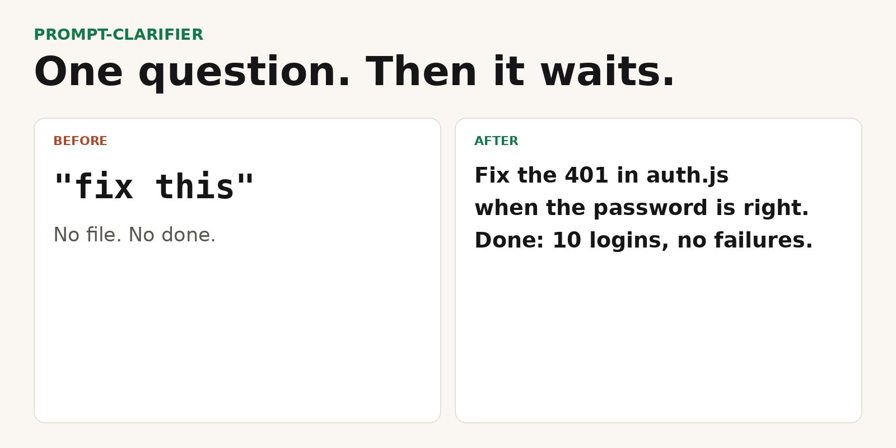

# prompt-clarifier

A Claude Code skill for a vague prompt. Also works in Cursor and Codex.

Half of bad AI output starts with a vague prompt. "Fix this." "Make it better." "Add login." You hit enter, wait, and get something close but not quite right — then spend ten minutes explaining what you actually meant.

prompt-clarifier catches that moment *before* you send it. It spots the one thing actually missing from your request — scope, target file, or what "done" means — and asks exactly that, nothing else. Clear enough already? It stays out of your way.

<p align="center">
  
</p>

**Before:**

> "fix this"

**After:**

> "Fix the bug in `auth.js` where login with a correct password sometimes returns 401 — looks like a race condition in token verification. Done when existing login tests pass and 10 consecutive logins don't fail once."

One clarifying question instead of one wrong guess.

[](https://github.com/David-Florian2013/prompt-clarifier/actions/workflows/ci.yml)
[](LICENSE)
[](https://github.com/David-Florian2013/prompt-clarifier/releases)

## Install

Claude Code, one command. Puts the skill in `~/.claude/skills/prompt-clarifier`.

```bash
npx --yes skills add David-Florian2013/prompt-clarifier -g -a claude-code -y -s prompt-clarifier
```

GitHub CLI (installs the latest release):

```bash
gh skill install David-Florian2013/prompt-clarifier prompt-clarifier --agent claude-code --scope user
```

`gh skill` needs [GitHub CLI 2.90.0 or newer](https://github.com/cli/cli/releases/tag/v2.90.0). It is still a public preview. This install was checked with 2.101.0. The `npx` line does not need `gh`.

Or copy the folder yourself. No package manager, no API key.

```bash
git clone --depth 1 https://github.com/David-Florian2013/prompt-clarifier.git
cd prompt-clarifier
./install.sh
```

**[Download prompt-clarifier.skill](https://github.com/David-Florian2013/prompt-clarifier/releases/latest/download/prompt-clarifier.skill)** — one file. Claude.ai: Settings → Capabilities → Code execution and file creation, then Customize → Skills → Upload a skill.

```bash
mkdir -p ~/.claude/skills
curl -fsSL -o /tmp/prompt-clarifier.skill \
  https://github.com/David-Florian2013/prompt-clarifier/releases/latest/download/prompt-clarifier.skill
unzip -o /tmp/prompt-clarifier.skill -d ~/.claude/skills
```

Restart the agent. If it does not pick the skill up, say `/prompt-clarifier`.

Cursor, Codex, and other hosts that read [Agent Skills](https://agentskills.io/specification): same `npx` command, swap `-a claude-code` for that host (`cursor`, `codex`). `npx skills add --help` lists them.

## What you get

One file: [`skills/prompt-clarifier/SKILL.md`](skills/prompt-clarifier/SKILL.md). No script, no dependency, no network call.

It triggers on a short or vague coding request ("fix this", "make it faster", "clean this up", "add login") and stays quiet when the request already names the target, the change, and how to tell it worked.

When it does speak, it does one of two things:

- Target unknown: one question. It does not invent a filename.
- Target known: a 2–4 sentence restatement of the *same* request, then it waits for "yes".

The before/after above is the shape of that restatement (example 5 in the skill). The file names and the "10 logins" check are the example, not a trace from a real session.

## When it stays out of the way

If you already said which file, what should change, and what done looks like, the skill's instruction is to do nothing and start the work. A second clarification round is friction.

## Claude Code plugin

Files are in [`.claude-plugin/`](.claude-plugin/). This path is not what CI runs:

```text
/plugin marketplace add David-Florian2013/prompt-clarifier
/plugin install prompt-clarifier@prompt-clarifier
```

`./install.sh` is the path CI checks.

## Limits

- Instructions for the agent. Nothing in this repo can force the model to follow them.
- It does not write code, run tests, or call an API.
- It will not fill a blank with `[fill in]`. If it cannot tell which file you mean, it asks.
- Examples in Czech and English are illustrations. The seconds and scores in them are not measurements.

## License

[MIT](LICENSE).
